<br />

<table>
<tr>
<td width="62%" valign="top">

## Hello, I'm XinAn.

浙江大学艺术🎨X科技💻专业，关注 **古画修复，交互体验与数字制造**。喜欢从真实使用情境出发，把模糊的问题整理成清晰的流程，再用视觉、代码和原型让想法可以被体验、测试与继续讨论。

目前正在探索：

- 古画修复+颜色计算+AR交互
- 3D资产生成与拓补
- 实体交互体验

详细作品集请见 https://xinan-annie.github.io/

</td>
<td width="38%" valign="top">

### NOW / 2026

`01` 设计研究与交互原型  
`02` Creative coding  
`03` 3D / Voxel / Fabrication  
`04` AI-assisted workflows

**Designing systems that feel clear, useful, and a little unexpected.**

</td>
</tr>
</table>

---

## Public projects / 公开项目

> 这里汇总了当前面向公众开放的项目。部分仍处于研究、课程或原型阶段，说明以各仓库 README 中的能力边界为准。

### 01 — [ArtGenome / 画基因](https://github.com/XinAn-Annie/Chinese-painting)

**传统绘画分析 × 本地 AI × 交互可视化**

面向古画学习、临摹与修复研究的本地交互平台：浏览器端完成颜色提取与传统色匹配，后端结合题跋区域检测、PaddleOCR、词云、印章位置热力图，以及本地 Qwen 赏析和五类技法相对倾向分析。追问时复用同一幅画的 OCR、颜色与技法结果，不重复识图。

`Interaction Design` `Data Visualization` `Canvas` `Plotly` `OCR` `Local Qwen`

### 02 — [PixelFold](https://github.com/XinAn-Annie/Voxel)

**计算几何 × 自适应体素化 × 3D 交互**

一个本地运行的 GLB 三维模型处理原型：后端分析几何并生成自适应体素，浏览器从原模型逐面采样颜色与贴图；还可将自适应体素按整数网格细分为统一尺寸体素，并导出 GLB。几何规划、外观采样和统一细分保持为三个相互独立的阶段。

`Computational Design` `Three.js` `FastAPI` `Trimesh` `Open3D` `libigl`

### 03 — [Desktop Pet Workspace](https://github.com/XinAn-Annie/desktop-pet-windows)

**桌面陪伴 × 个人效率 × 本地优先**

一个 Windows 桌面宠物与日程工作台原型。它把桌面陪伴、日历、DDL、图片剪贴板、本地 OCR 与信息提醒整合在一起，支持自定制宠物形象与标签，尝试用更轻松的交互降低日常任务管理的压力。

`Product Prototype` `Desktop UX` `Python` `Tkinter` `Local OCR`

### 04 — [Rhino Qwen Precision Agent](https://github.com/XinAn-Annie/RhinoQwenPrecisionAgent)

**参数化建模 × Qwen × Rhino MCP**

面向 Rhino 8 的独立本地建模智能体 PoC。它把中文尺寸与约束转换为受控 `ModelingSpec`，经确定性脚本执行、几何验收和有限轮次修复后写入 Rhino；支持法兰、外壳、阶梯轴、草图拉伸、圆角/倒角、放样与多零件装配等已声明模板。它是受控参数化系统，不等同于任意机械 CAD。

`Rhino 8` `Qwen API` `MCP` `Python` `Geometry Validation`

### 05 — [真人帮 / Zhenrenbang](https://github.com/XinAn-Annie/Zhenrenbang)

**真实经验互助 × 双端订单 × 实时沟通**

围绕“真人、现场经验与适应性判断”设计的本地双设备服务原型，包含发布与接单、持久化聊天、订单状态、评价，以及接单后才开放的 WebRTC 视频指导。登录、支付和身份审核目前属于课程演示，临时 HTTPS 地址仅用于联调，并非正式线上服务。

`Service Design` `Node.js` `SQLite` `WebRTC` `Mobile Web`

### 06 — [Personal Portfolio / 个人作品集](https://github.com/XinAn-Annie/XinAn-Annie.github.io)

**交互设计 × 文化科技 × HCI 研究**

英文优先、支持中英双语的个人作品集网站，集中呈现交互设计、文化科技、数字产品与研究项目。图片和视频经过响应式优化，并由 GitHub Actions 自动构建发布。

[访问网站 →](https://xinan-annie.github.io/)

`Portfolio` `React` `Responsive Media` `GitHub Pages`

### 07 — [Landscape Impressionism LoRA](https://github.com/XinAn-Annie/Landscape-Impressionism_Lora)

**生成式图像 × 风景印象主义视觉倾向**

面向 Z-Image 工作流的 LoRA 权重，可在支持 LoRA 的界面中加载并调节强度，用于生成具有风景印象主义视觉倾向的图像。

`Generative AI` `LoRA` `Z-Image` `Visual Experiment`

---

## How I work

```text
observe  →  frame the problem  →  prototype  →  test  →  refine
观察          定义问题              原型         验证      迭代
```

我的工作不只停在视觉呈现，也包括需求梳理、交互流程、可运行原型与输出验证。我在意每一个设计决定能否回到真实的人、场景与限制中。

---

## Tools I use

| Design | Build | Explore |
| :--- | :--- | :--- |
| Figma · Adobe tools · Visual systems | HTML/CSS/JS · Python · Git · Three.js |  Plotly · OCR · 3D workflows |

---

## Let's connect

[](https://space.bilibili.com/1359086443)

<sub>Open to conversations about interaction design, creative technology, cultural visualization and experimental tools.</sub>


