<br />

<table>
<tr>
<td width="62%" valign="top">

## Hello, I'm XinAn.

浙江大学艺术🎨X科技💻专业，关注 **古画修复，交互体验与数字制造**。我喜欢从真实使用情境出发，把模糊的问题整理成清晰的流程，再用视觉、代码和原型让想法可以被体验、测试与继续讨论。

目前正在探索：

- 古画修复+颜色计算+AR交互
- 3D资产生成与拓补
- 实体交互体验

</td>
<td width="38%" valign="top">

### NOW / 2026

`01` 设计研究与交互原型  
`02` Creative coding  
`03` 3D / Voxel / Fabrication  
`04` AI-assisted workflows

**Designing systems that feel clear, useful, and a little unexpected.**

</td>
</tr>
</table>

---

## Selected work

> 部分项目仍在私有开发中。这里展示的是经过核对的项目方向与真实功能边界。

### 01 — ArtGenome / 画基因

**传统绘画色彩研究 × 交互可视化**

构建面向古画学习与研究的多模态智能平台。用户上传古画图像后，平台通过 K-means 色彩聚类分析画面色彩分布，并辅助推测原始色彩；采用自训练模型检测与识别题跋文字；支持接入千问等大语言模型，对画面内容及题跋信息进行综合分析，并结合外部知识库补充相关历史与艺术背景，为古画学习、研究与鉴赏提供辅助。

`Interaction Design` `Data Visualization` `Canvas` `Plotly` `Three.js` `OCR`

### 02 — Voxel Slicer

**数字制造 × 计算几何 × 纸艺展开**

将三维模型转换为可制作的纸艺展开图。工作流覆盖模型导入、加权体素化与拓补、连通性处理、展开、色彩加载，以及 SVG / DXF / PDF 制造文件输出；也持续探索从数字形态到实体构造之间更可靠的设计流程。

`Digital Fabrication` `3D Workflow` `Python` `SVG` `DXF` `PDF`

### 03 — [Desktop Pet Workspace](https://github.com/XinAn-Annie/desktop-pet-windows)

**桌面陪伴 × 个人效率 × 本地优先**

一个 Windows 桌面宠物与日程工作台原型。它把桌面陪伴、日历、DDL、图片剪贴板、本地 OCR 与信息提醒整合在一起，支持自定制宠物形象与标签，尝试用更轻松的交互降低日常任务管理的压力。

`Product Prototype` `Desktop UX` `Python` `Tkinter` `Local OCR`

---

## How I work

```text
observe  →  frame the problem  →  prototype  →  test  →  refine
观察          定义问题              原型         验证      迭代
```

我的工作不只停在视觉呈现，也包括需求梳理、交互流程、可运行原型与输出验证。我在意每一个设计决定能否回到真实的人、场景与限制中。

---

## Tools I use

| Design | Build | Explore |
| :--- | :--- | :--- |
| Figma · Adobe tools · Visual systems | HTML/CSS/JS · Python · Git · Three.js |  Plotly · OCR · 3D workflows |

---

## Let's connect

[](https://space.bilibili.com/1359086443)

<sub>Open to conversations about interaction design, creative technology, cultural visualization and experimental tools.</sub>


